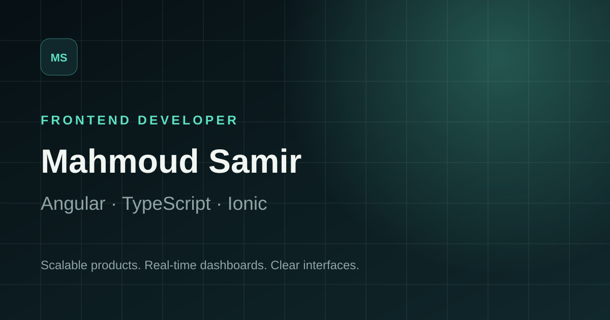

# Mahmoud Samir — Developer Portfolio

A polished, responsive portfolio for Mahmoud Samir, an Angular Frontend Developer based in Cairo, Egypt. It presents verified professional experience, technical strengths, and privacy-safe case studies for international remote opportunities.



## Highlights

- Premium dark interface with a complete light theme
- Responsive, accessible navigation and keyboard-friendly interactions
- Angular 20 standalone components with lazy-loaded routes
- Data-driven skills, social links, and project case studies
- Dedicated project routes with original illustrative dashboard visuals
- Reduced-motion support and semantic page structure
- Downloadable CV and functional email, GitHub, and LinkedIn links
- SEO, Open Graph, Twitter card, favicon, and robots metadata
- Vercel SPA rewrite configuration for reliable route refreshes
- Automated tests for the app shell and portfolio data integrity

## Stack

- Angular 20
- TypeScript 5.9
- SCSS
- Angular Router and Signals
- Jasmine and Karma

## Architecture

```text
src/app/
├── core/
│   ├── data/          # Typed portfolio content
│   ├── models/        # Domain interfaces
│   └── services/      # Theme state and persistence
├── features/
│   ├── about/
│   ├── contact/
│   ├── experience/
│   ├── home/
│   └── projects/      # Listing and routed case studies
└── shared/components/ # Navigation, cards, visuals, icons, footer
```

Content is separated from presentation in `portfolio.data.ts`. Project cards and case-study pages consume the same strongly typed source to prevent drift.

## Local development

Prerequisites: Node.js 20.19+ or 22.12+ and npm 10+.

```bash
npm install
npm start
```

Open `http://localhost:4200`.

## Quality checks

```bash
npm run typecheck
npm run test:ci
npm run build
```

The production output is written to `dist/mahmoud-portfolio/browser`.

## Deployment

The project includes `vercel.json` so Angular client-side routes resolve to `index.html` when refreshed on Vercel.

```bash
npm run build
npx vercel --prod
```

## Content and confidentiality

Professional case studies summarize verified responsibilities from Mahmoud's CV. Their visuals are original portfolio illustrations—not production screenshots. No employer source code, credentials, endpoints, or customer information are included.

## Contact

- [LinkedIn](https://www.linkedin.com/in/mahmoud-samir587766247)
- [GitHub](https://github.com/mahmoudsamir-design)
- [Email](mailto:Mahmoud.samirr148@gmail.com)

© Mahmoud Samir. Built with Angular.
